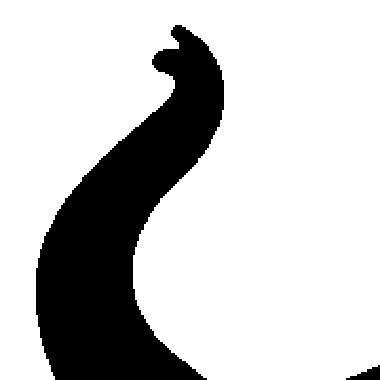
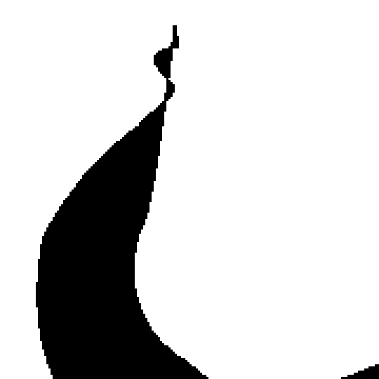

# Image Smoothing with Bezier Curves

[](LICENSE)
[](#error-handling)

A university project for smoothing black and white images using Bezier curve approximation and the Douglas-Peucker simplification algorithm.

## Before / After

The tool converts a raster PBM image into smooth vector contours. Below: `samples/elephant.pbm` (left) and its output rendered from the generated EPS (`-t 3 -d 3 -m fill`, right).

<table>
  <tr>
    <th align="center">Before &mdash; raster (PBM)</th>
    <th align="center">After &mdash; smoothed Bezier curves (EPS)</th>
  </tr>
  <tr>
    <td></td>
    <td></td>
  </tr>
  <tr>
    <th align="center">Before &mdash; 3&times; zoom</th>
    <th align="center">After &mdash; 3&times; zoom</th>
  </tr>
  <tr>
    <td></td>
    <td></td>
  </tr>
</table>

The full-size images are 800&times;700; the zoom crops show how the pixel stair-casing of the input becomes a smooth curve in the output.

## Project Structure

```
.
├── include/          # Header files
│   ├── image.h       # Image handling functions
│   ├── geom2d.h      # 2D geometry primitives
│   ├── bezier.h      # Bezier curve functions
│   └── calcul_contour.h  # Contour extraction and simplification
├── src/             # Source files
│   ├── image.c
│   ├── geom2d.c
│   ├── bezier.c
│   └── calcul_contour.c
├── tests/            # Test programs
│   ├── test_image.c
│   ├── test_geom2d.c
│   ├── test_contour.c
│   ├── test_bezier.c
│   ├── test_bezier3.c
│   ├── test_douglas_bezier2.c
│   └── test_simplific_douglas.c
├── samples/          # Sample PBM images
├── Makefile         # Build system
└── README.md        # This file
```

## Features

- **PBM Image Handling**: Read black and white images in PBM ASCII (P1) and binary (P4) formats
- **Contour Extraction**: Extract contours from black and white images using a tracing algorithm
- **Bezier Curve Approximation**: Approximate contours using quadratic (Bezier2) and cubic (Bezier3) Bezier curves
- **Douglas-Peucker Simplification**: Simplify contours using the Douglas-Peucker algorithm
- **EPS Output**: Generate EPS (Encapsulated PostScript) files from contours and Bezier curves
- **SVG Output**: Generate SVG (Scalable Vector Graphics) files from contours and Bezier curves
- **Unified CLI**: User-friendly command-line interface with comprehensive options

**Supported Output Formats:**
- `eps` - Encapsulated PostScript (default)
- `svg` - Scalable Vector Graphics

## Building

```bash
make clean
make main
```

This will compile the main program (`image_smoother`) to the `bin/` directory.

To build all test programs:
```bash
make tests
```

To build everything (main program and all tests):
```bash
make everything
```

To build a specific test:
```bash
make test_image
make test_contour
make test_bezier3
```

To clean up:
```bash
make clean
```

## Usage

### Main CLI Program

The main program `image_smoother` provides a unified interface for all functionality:

```bash
./image_smoother [OPTIONS] <input.pbm>
```

**Options:**
- `-o, --output FILE` - Output file name (without extension)
- `-t, --threshold N` - Simplification threshold (default: 1)
- `-d, --degree N` - Bezier degree: 2 for quadratic, 3 for cubic (default: 2)
- `-m, --mode MODE` - Drawing mode: 'stroke' or 'fill' (default: stroke)
- `-f, --format FMT` - Output format: 'eps' (default: eps)
- `-v, --verbose` - Enable verbose output
- `-l, --list` - List available sample images
- `-h, --help` - Show help message

**Examples:**
```bash
# Process with quadratic Bezier curves
./image_smoother samples/test1.pbm -o output -t 2 -d 2

# Process with cubic Bezier curves in fill mode
./image_smoother samples/tete.pbm -o my_output -t 3 -d 3 -m fill

# Verbose mode
./image_smoother samples/elephant.pbm --threshold 5 --degree 2 --verbose

# List available samples
./image_smoother --list
```

### Legacy Test Programs

The original test programs are still available for backward compatibility:

#### test_image
Displays an image and its negative.
```bash
./test_image samples/test1.pbm samples/test2.pbm
```

#### test_geom2d
Tests geometric functions (distance calculations, etc.).
```bash
./test_geom2d
```

#### test_contour
Extracts contours from images and saves them as EPS files.
```bash
./test_contour stroke samples/test1.pbm
./test_contour fill samples/test1.pbm
```

#### test_simplific_douglas
Simplifies contours using Douglas-Peucker algorithm.
```bash
./test_simplific_douglas stroke samples/test1.pbm
```
Note: The program will prompt for a threshold value.

#### test_bezier
Tests Bezier curve approximation (quadratic).
```bash
./test_bezier
```

#### test_bezier3
Tests Bezier curve approximation (cubic) and saves results as EPS.
```bash
./test_bezier3 stroke samples/test1.pbm
```
Note: The program will prompt for a threshold value.

#### test_douglas_bezier2
Tests Douglas-Peucker simplification with quadratic Bezier curves.
```bash
./test_douglas_bezier2 stroke samples/test1.pbm
```
Note: The program will prompt for a threshold value.

## File Formats

### Input Files
- **PBM (P1 format)**: Black and white images with ASCII representation
  - First line: `P1`
  - Comments: Lines starting with `#`
  - Dimensions: Width and height
  - Pixel data: `0` for white, `1` for black
- **PBM (P4 format)**: Black and white images with binary packed representation
  - First line: `P4`
  - Same header rules as P1 (`#` comments, width, height)
  - Exactly one whitespace byte after the height, then
  - Pixel data: each row packed into `(width + 7) / 8` bytes, most
    significant bit first; a set bit is a black pixel. Bits beyond `width`
    in the last byte of each row are padding and ignored.
  - Produced by most standard tools (ImageMagick, netpbm, GIMP binary export)

Both formats can be used interchangeably anywhere an input image is accepted.

### Output Files
- **EPS**: Encapsulated PostScript files for vector graphics
  - Can be viewed with Ghostscript, Adobe Illustrator, etc.
  - Supports both `stroke` and `fill` modes

## Error Handling

The program follows a **fail fast** policy: on any unrecoverable error it prints a
diagnostic message to standard error and exits with a non-zero status. No partial
output file is written, since all errors below occur before the output stage.

### Malformed input files

| Condition | Message (stderr) |
|---|---|
| File cannot be opened | `Error: Cannot open input file '<name>'` |
| First line is not `P1` or `P4` | `entete_fichier_pbm : ligne 1 incorrecte` |
| File ends inside the header/comment section | `entete_fichier_pbm : fin fichier inattendue` |
| Missing or non-numeric width/height | `lire_fichier_image : dimension L/H incorrecte` |
| P4: no whitespace byte between the height and the raster | `lire_fichier_image : separateur manquant avant les donnees binaires P4` |
| P4: binary raster ends before `H x ceil(L/8)` bytes | `lire_fichier_image : donnees binaires P4 incompletes` |

Known lenient behavior: in P1 files any character other than `0` or `1` is skipped,
and if the pixel data ends early the remaining pixels are silently left white.

### Memory exhaustion

Every heap allocation in the program is checked, including image buffers, contour
lists, and the Bezier/contour arrays. If an allocation fails, the program prints an
`allocation impossible`-style message to stderr and exits with a non-zero status
(`exit(1)` in the image module, `exit(-1)` in the geometry/Bezier modules). No
manual cleanup is attempted on abort; the operating system reclaims the process
memory at exit.

### Valgrind verification

The `valgrind : 0 errors, 0 leaks` badge above is backed by `valgrind --leak-check=full`
runs of `image_smoother` across P1 and P4 inputs, both Bezier degrees, `stroke`/`fill`
modes, and EPS/SVG output — all reporting `0 bytes in use at exit` and
`ERROR SUMMARY: 0 errors from 0 contexts`.

## Implementation Details

### Contour Extraction Algorithm
1. Scan the image to find edge pixels (black pixels with white pixels above)
2. For each edge pixel, trace the contour using a direction-based algorithm
3. Store contours as linked lists of points

### Bezier Curve Approximation
- **Quadratic (Bezier2)**: Uses 3 control points (C0, C1, C2)
- **Cubic (Bezier3)**: Uses 4 control points (C0, C1, C2, C3)
- Control points are calculated to minimize the distance between the original contour and the Bezier curve

### Douglas-Peucker Simplification
- Recursively simplifies contours by removing points that are within a threshold distance from the line segment
- Can be applied to both raw contours and Bezier curve approximations

## License

This project is released under the [MIT License](LICENSE).

